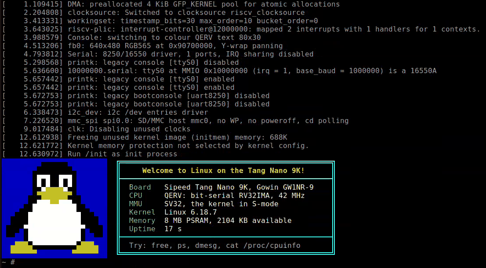

# Linux on a Tang Nano 9K

[](https://github.com/phoenix367/tang_nano_9K_linux/actions/workflows/ci.yml)

This is an experimental project. I wanted to find out whether a board as small as the Sipeed
Tang Nano 9K can run Linux at all: its GW1NR-9 FPGA has 8,640 LUTs and 8 MB of PSRAM in the
package. It can.
- A bit-serial RISC-V soft CPU runs in the FPGA, with the PSRAM as main memory.
- A mainline Linux kernel with SV32 virtual memory boots on it to a BusyBox shell. It's slow:
  the CPU runs about 2 million instructions per second.
- The HDMI output shows a boot splash, then a text console that mirrors the serial shell.



## What runs

- **Linux 6.18.7**, built with Buildroot (uClibc-ng, BusyBox, initramfs). The kernel runs in
  S-mode with SV32 paging, under a small SBI v0.1 shim in the boot ROM. User space has real
  `fork`, pipes and `/dev/fb0`.
- **On its own:** at power-up the board autoboots the kernel from its SPI flash. The shell
  prompt appears about 25 s after power-up.
- **Memory:** of the 8 MB, about 2 MB is free after boot. That is room for BusyBox and a
  few processes, not for a general-purpose distribution.
- An earlier no-MMU kernel, running in M-mode, boots on the same SoC too (stage 1).

## Hardware

The board is a Sipeed Tang Nano 9K:
- a Gowin GW1NR-LV9QN88PC6/I5 FPGA, with 8,640 LUT4s and 26 block RAMs;
- 64 Mbit of PSRAM in the package, plus a 32 Mbit SPI flash;
- a microSD slot and an HDMI connector.

The SoC (`rtl/`) runs on one 42 MHz clock, with a separate 25.2 MHz pixel clock for video:

- **CPU (QERV):** [Sparrow-SERV](https://github.com/phoenix367/sparrow-serv), a fork of
  [SERV](https://github.com/olofk/serv), processing 4 bits per cycle.
  - Around it: an M-extension unit (DSP multiplier, serial divider), an AMO unit for the A
    extension, and an SV32 MMU with its TLB in block RAM.
  - ISA: RV32IMA with Zicsr, Zifencei and Zicbom, in M, S and U modes.
  - Speed: about 12 cycles per ALU instruction and 22 per load or store, before memory
    wait states.
- **Cache:** 16 KB, unified and write-back, in front of the PSRAM. The video DMA shares the
  PSRAM with it.
- **PSRAM controller:** the project's own (`rtl/psram/`). It runs both PSRAM dies in
  lockstep as one 16-bit bus at 42 MHz, without calibration. It replaced Gowin's PSRAM IP.
- **Peripherals:**
  - a 16550-style UART at 1 Mbaud, with 256-byte FIFOs;
  - a CLINT and a minimal PLIC;
  - a read-only window onto the SPI flash;
  - HDMI video: a 640×480 RGB565 framebuffer and an 80×30 hardware text mode;
  - an OpenCores I2C master;
  - an SPI master for the microSD slot.
- **Boot ROM:** a serial monitor (load, hash, memory test, boot). It also draws the splash
  and autoboots Linux from the SPI flash.

The design uses 65% of the logic and 24 of the 26 block RAMs. It meets 42 MHz with an Fmax
of 45.2 MHz (see Timing below).

### Memory map

| Address | Device |
| --- | --- |
| `0x0000_0000` | Boot ROM |
| `0x1000_0000` | UART |
| `0x1100_0000` | CLINT |
| `0x1110_0000` | SYSCON: power off, reboot, status counters, video registers |
| `0x1130_0000` | I2C master |
| `0x1140_0000` | SPI master (microSD) |
| `0x1180_0000` | Text-mode buffer (80×30 cells) |
| `0x1200_0000` | PLIC |
| `0x2000_0000` | SPI flash, 4 MB, read-only |
| `0x8000_0000` | PSRAM, 8 MB, cached |
| `0x9000_0000` | The same PSRAM, uncached |

### Connections

- **Console:** the board's USB bridge, `/dev/ttyUSB1` on Linux, at 1,000,000 baud 8N1.
- **HDMI:** the board's connector. It shares pins 68–75 with the LCD connector, so leave
  that connector empty.
- **I2C:** SDA on pin 25, SCL on pin 26 (3.3 V, open drain).
- **microSD:** the board's slot (pins 36–39).
- **Reset:** pin 3. On the board this was developed on, that is the button printed "S2";
  Sipeed's schematic calls pin 4 S2, so check yours.

## Status

Working on the board:
- the MMU kernel and the no-MMU kernel;
- HDMI framebuffer, text console and splash;
- serial interrupts and I2C;
- microSD reads, at about 72 KB/s;
- the cache-block operations;
- the 16-bit PSRAM controller: an 8 MB memory test, a UART boot and the power-up autoboot.
  The board's internal flash holds this build.

Open problems:
- **microSD writes.** In the first write test, most of the file read back as zeros
  (`doc/peripherals.md`). Don't write to a card whose contents you need.
- **Timing.** The real Fmax is 45.2 MHz against 42, thanks to a 1.5 ns setup guard band in
  the SDC (`set_clock_uncertainty`). Without it the same design placed to 39.3 MHz, so
  check every build.
- **No FPU.** User space is built soft-float.

## Getting started

### Requirements

- Gowin EDA 1.9.12, for the headless `gw_sh` and `programmer_cli`. Set `GOWIN_PATH` to the
  install (default `/mnt/data/Gowin_V1.9.12.02_SP2_linux`).
- openFPGALoader.
- Python 3 with pyserial and Pillow.
- The host packages Buildroot needs. `sw/build.sh` fetches Buildroot 2026.08.1 and builds
  the toolchain itself.
- For simulation and tests: Verilator, Icarus Verilog, and a bare-metal RISC-V GCC
  (`riscv64-unknown-elf`).

Kernel builds, the flash tools and the SoC simulation keep their files in `$WORK`, which
defaults to `/mnt/data/build/tang9k_linux`. The FPGA build stays in `fpga/`.

```sh
git clone --recursive https://github.com/phoenix367/tang_nano_9K_linux.git
```

### Or build in Docker

`docker/bootstrap.sh` builds an Ubuntu 24.04 image with everything except the Gowin tools:
- Buildroot's host packages;
- the bare-metal RISC-V GCC;
- Icarus Verilog and Verilator;
- Python with pyserial and Pillow;
- openFPGALoader;
- the libraries Gowin's tools need.

`docker/run.sh` runs a command in it:

```sh
docker/bootstrap.sh --gowin-path /path/to/Gowin_V1.9.12.02_SP2_linux   # once; ~1.8 GB image
docker/run.sh env CONFIG=mmu sw/build.sh          # kernel + DTB
docker/run.sh env SMODE=1 VIDEO=1 fpga/build.sh   # bitstream (the licence server must be reachable)
docker/run.sh scripts/ci.sh all                   # the CI checks
docker/run.sh                                     # a shell
```

The repository is mounted at `/work`. The Gowin install is mounted read-only at
`/opt/gowin`; it is never copied into the image. The container's builds go to a directory
of their own (`/mnt/data/build/tang9k_linux/docker` by default, `--work-dir`), at `/build`
inside. Buildroot's download cache is shared with the host build when there is one
(`--dl-dir`). USB and the console UART are passed through, so the board tools work from the
container too.

### Build

```sh
SMODE=1 VIDEO=1 fpga/build.sh    # bitstream: fpga/impl/pnr/tang9k_soc.fs (~2 min)
CONFIG=mmu sw/build.sh           # Image + DTB in $WORK/images-tang9k-mmu/ (~40 min the first time)
```

### Run

```sh
sw/tools/qerv_boot.py --bitstream fpga/impl/pnr/tang9k_soc.fs --linux --mmu --console
```

This:
1. loads the bitstream into the FPGA's SRAM;
2. uploads the kernel and device tree over the UART, checking both;
3. boots the kernel;
4. opens a terminal on the console (Ctrl-] quits).

To make the board boot Linux on its own, write both flashes:

```sh
sw/tools/flash_linux.sh mmu                                   # kernel, DTB, splash -> SPI flash
openFPGALoader -b tangnano9k -f fpga/impl/pnr/tang9k_soc.fs   # bitstream -> internal flash
```

`sw/tools/console.sh` opens a terminal on the console later. The board's USB bridge keeps
the baud rate of the previous open of the port; the script and `qerv_boot.py` work around
that.

## Simulation and tests

`scripts/ci.sh [cpu|units|soc|all]` runs every check that needs neither the Gowin tools nor
the board nor a kernel build. GitHub Actions runs it on every push
(`.github/workflows/ci.yml`). The pieces:

- `sim/soc/run.sh`: Verilator simulation of the whole SoC, booting the real kernel
  (`CONFIG=mmu` for the MMU kernel). It runs at about 2.4 MHz, so a boot to the shell takes
  many minutes.
- `verif/qerv/run_directed.sh` and `verif/qerv/run_riscv_tests.sh` (add `SMODE=1` for the
  MMU CPU):
  - directed CPU tests, run in lockstep with a Python reference model;
  - the riscv-tests suites.
- Unit tests:
  - `verif/cache/run.sh`: cache and PSRAM arbiter.
  - `verif/psram16/run.sh`: the 16-bit PSRAM controller against two die models, and its
    cycle model.
  - `verif/video/run.sh` and `verif/video/run_sys.sh`: video output, and video under CPU
    load.
  - `verif/uart/run.sh`, `verif/i2c/run.sh`, `verif/spi/run.sh`: the other peripherals.
- `sw/tests/`: bare-metal programs for the SoC simulation and the board.

## Repository layout

| Path | Contents |
| --- | --- |
| `rtl/qerv/` | CPU wrapper (Sparrow-SERV + MDU + AMO unit), SV32 MMU |
| `rtl/soc/` | SoC top, cache, PSRAM arbiter, UART, CLINT, PLIC, SYSCON, flash window, SPI, boot ROM |
| `rtl/video/` | Video controller, DMA, text mode, TMDS encoder, HDMI PHY, font |
| `rtl/i2c/` | OpenCores I2C master |
| `rtl/psram/` | 16-bit PSRAM controller |
| `rtl/sim/` | Simulation models (PSRAM, SPI flash, I2C EEPROM) |
| `fpga/` | Gowin project, board top, constraints, PLLs, `build.sh`, CPU-less probes; the retired Gowin PSRAM IP netlist, kept for `fpga/probe/` |
| `sw/bootrom/` | Boot ROM monitor and SBI shim |
| `sw/br2-external/` | Buildroot tree: defconfigs, kernel configs, device trees, kernel patches, root filesystem overlays |
| `sw/tools/` | Board tools: `qerv_boot.py`, `flash_linux.sh`, `console.sh`, `mksplash.py` |
| `sim/soc/` | Whole-SoC Verilator simulation and profiling |
| `verif/` | Unit tests |
| `fit/` | Fit probes: one CPU core alone on this FPGA, for its size and Fmax |
| `perf/` | Boot-time model (CPI measurement, emulator traces) and the on-board benchmarks (`perf/board/`) |
| `doc/` | Architecture, plans and results (`doc/README.md` is the map) |
| `external/` | Submodules |
| `.claude/skills/` | Claude Code skills for loading kernels and bitstreams |

## Documentation

`doc/README.md` is the document map. The main documents:

- [`doc/01-architecture.md`](doc/01-architecture.md): the hardware architecture: block
  diagram, clocks and reset, memory and arbitration, interfaces, verification, timing and
  resources, open issues.
- `doc/stage1_plan.md`: the no-MMU stage, milestones M0–M4, and the design decisions.
- `doc/stage2_plan.md`: the MMU stage.
- `doc/video_plan.md`: HDMI video and the text console.
- `doc/peripherals.md`: I2C and the microSD card.
- `doc/psram_controller.md`: the 16-bit PSRAM controller.
- `doc/performance.md`: benchmark results from the board (CPU, kernel, memory).
- `CLAUDE.md`: detailed working notes, with build commands, hardware gotchas and
  measurements. The project is developed with Claude Code, and this file is its memory.

## Credits and licenses

This repository is under the MIT license (`LICENSE`), with these exceptions:

- `external/sparrow-serv`: [Sparrow-SERV](https://github.com/phoenix367/sparrow-serv), under ISC
  like SERV, by Olof Kindgren.
- `external/mdu`: the M-extension unit for SERV, under Apache-2.0.
- `rtl/i2c/`: the OpenCores I2C master by Richard Herveille, under its original notice.
- `fpga/src/psram_memory_interface_hs_2ch/`: Gowin's PSRAM Memory Interface IP, generated by
  Gowin EDA (no longer in the SoC; kept for a probe).
- `rtl/video/font8x16.hex`: the Linux kernel's 8×16 CP437 font (GPL-2.0).
- `sw/br2-external/patches/linux/`: patches to the Linux kernel (GPL-2.0).

Also used:
- [KianV](https://github.com/splinedrive/kianRiscV), as prior art;
- [mini-rv32ima](https://github.com/cnlohr/mini-rv32ima), for boot traces;
- [riscv-tests](https://github.com/riscv-software-src/riscv-tests);
- Buildroot.

The headless Gowin flow, and the Gowin PSRAM IP setup the SoC used until 2026-11, come from
an earlier Tang Nano 9K project with an OV7670 camera.
