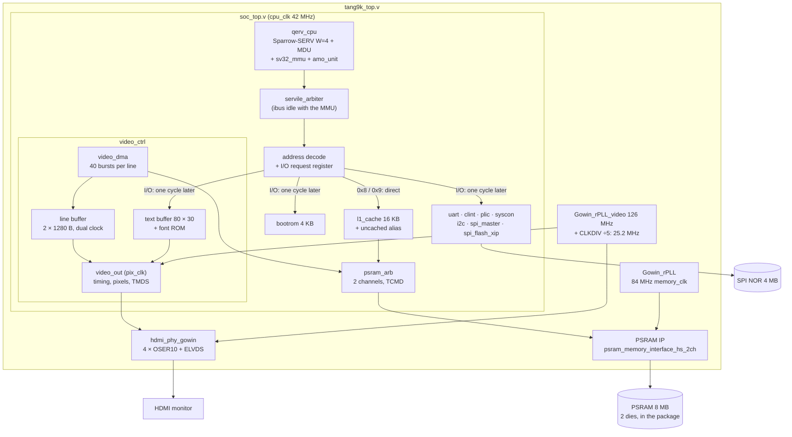
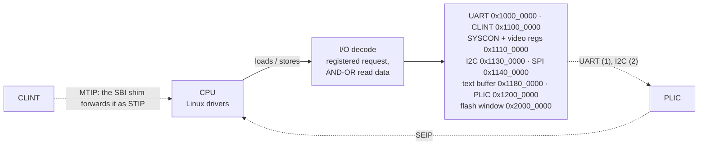
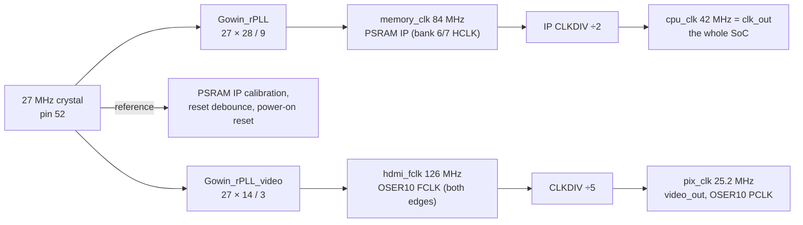
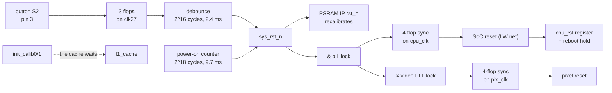
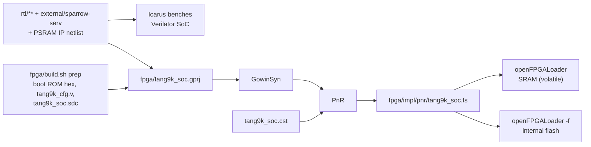

# tang_nano_9k_linux — hardware architecture

The gateware turns a Sipeed Tang Nano 9K into a small Linux computer. A soft RISC-V CPU
sits in the board's Gowin GW1NR-9, around it:
- a 16 KB cache in front of the 8 MB PSRAM in the FPGA package;
- an HDMI video controller with a framebuffer and a hardware text mode;
- a UART, a timer (CLINT) and an interrupt controller (PLIC);
- an I2C master, an SPI master for the microSD slot, and a read window on the SPI flash;
- a boot ROM with a serial monitor and an SBI shim.

The CPU runs Linux 6.18 with SV32 virtual memory and drives all of them. This document
describes the hardware in the order of an FPGA architecture document: requirements,
top-level structure, clocks and reset, memory, datapath, interfaces, verification, and
implementation. The numbers are those of the bitstream `tang9k_soc_cbo.fs` (2026-11-11,
`SMODE=1 VIDEO=1`; the implementation reports in `fpga/impl/` of 2026-11-11 13:40, a rebuild
of the same design) and the Zicbom MMU kernel, unless a section says otherwise.

| topic | document |
|---|---|
| the no-MMU stage: milestones M0–M4, memory map, the CPU's Linux extensions | [stage1_plan.md](stage1_plan.md) |
| the MMU stage: S-mode, the SV32 MMU, boot-time work | [stage2_plan.md](stage2_plan.md) |
| HDMI: the video controller, the text console, the boot splash | [video_plan.md](video_plan.md) |
| I2C and the microSD card | [peripherals.md](peripherals.md) |
| build commands, board tools, gotchas, measurements | [`CLAUDE.md`](../CLAUDE.md) |
| what the project is and how to start | [`README.md`](../README.md) |
| the CPU core's changes against upstream SERV | `external/sparrow-serv/README.md` |

---

## 1. Executive summary and system requirements

### 1.1 What the hardware does

The CPU is **QERV**, built around [Sparrow-SERV](https://github.com/phoenix367/sparrow-serv),
a fork of the bit-serial SERV core:
- 4 bits per cycle (`W=4`) at 42 MHz;
- RV32IMA with Zicsr, Zifencei and Zicbom, in M, S and U modes;
- an SV32 MMU outside the core, a serial divider and a DSP multiplier, and an AMO unit;
- one hart, one memory access at a time, no branch prediction and no pipeline overlap.

The fabric adds these blocks around it:

| block | does | rate |
|---|---|---|
| **qerv_cpu** (`rtl/qerv/`) | Sparrow-SERV `LINUX=1 SMODE=1`, `mdu_top` (M extension), `amo_unit` (A extension), `sv32_mmu` (256-entry TLB in block RAM, one-page micro-TLB per bus) | 12 cycles per ALU instruction, 22 per load/store before wait states (§5.4) |
| **l1_cache** (`rtl/soc/l1_cache.v`) | 16 KB unified, direct-mapped, write-back, 32-byte lines; the uncached alias; cache-block operations | hit: ack 2 cycles after the request |
| **psram_arb** (`rtl/soc/psram_arb.v`) | shares the PSRAM IP's two channels between the cache and the video DMA; the IP's register stage | one 32-byte burst per channel per 19 cycles: 70.7 MB/s per channel |
| **PSRAM IP** (Gowin `psram_memory_interface_hs_2ch`, generated netlist) | 8 MB in two 4 MB dies, a 32-bit user port per channel, 8-beat bursts | memory clock 84 MHz; read latency 16 cycles of 42 MHz |
| **video_ctrl** (`rtl/video/`) | 640 × 480 at 60 Hz: framebuffer scan-out (RGB565) with Y-wrap panning, an 80 × 30 text mode, TMDS encoding; `hdmi_phy_gowin` serializes | 25.2 MHz pixel clock, 252 Mbit/s per TMDS lane; 36.9 MB/s of framebuffer reads |
| **uart_16550** | 16550 register subset, 256-byte FIFOs in block RAM, interrupt | 1 Mbaud 8N1, fixed |
| **plic**, **clint** | 2 interrupt sources to the S external interrupt; mtime at 1 MHz, mtimecmp | |
| **i2c** (`rtl/i2c/`) | the OpenCores I2C master (Richard Herveille's) | 100 kHz in the DT |
| **spi_master** | the microSD slot in SPI mode, hardware CRC16 for the data blocks | SCK up to 21 MHz; 72 KB/s file reads measured |
| **spi_flash_xip** | a read-only window on the 4 MB SPI NOR flash | READ (0x03) at SCK 21 MHz |
| **bootrom** (`sw/bootrom/bootrom.S`) | 4 KB: serial monitor, flash autoboot, boot splash, SBI v0.1 shim | |
| **syscon** | power off, reboot, status counters (PSRAM commands, cache misses and write-backs), the video registers | |

Everything shares one memory. The CPU reaches the PSRAM through the cache; the video DMA
reads lines straight from PSRAM through the arbiter. The CPU writes the framebuffer through
the uncached alias (`0x9xxx_xxxx`), so nothing for the display sits in the cache. There is
no other bus master.

### 1.2 Target applications, throughput and latency

The project has no external requirement specification. Its targets were set as it went:
- a Linux kernel and a BusyBox shell on the board, first without an MMU (stage 1, M-mode),
  then with SV32 paging (stage 2), in 8 MB of RAM;
- a board that boots Linux on its own from its flashes;
- HDMI output: a boot splash, then a console;
- the board's I/O: I2C and the microSD card.

Measured on the board (2026-11-10/11):

| workload | result |
|---|---|
| power-up to the shell (both flashes, autoboot) | `Run /init` 19.8 s and `~ #` 24.6 s after the boot ROM's prompt; the ROM copies 3.4 MB from flash first |
| kernel boot, UART-loaded (`B` to `Run /init`) | 12.4 s |
| memory after boot (`free`) | 2,100 KB available of 8,192 KB |
| `dmesg` to the serial console | 1.3 s with the UART interrupt (6.9 s polled) |
| `dmesg` to the HDMI text console (`/dev/tty1`) | 2.8 s (55 s with fbcon on the framebuffer) |
| microSD read, 1 MB | 72 KB/s through the file system, 95 KB/s raw (`iflag=direct`) |
| video scan-out | 649 frames without an underflow; `Run /init` 8.86 s with scan-out on, 8.87 s off |
| full-SoC simulation to the shell (Verilator) | ~2.4 MHz simulated; a boot takes several minutes |

What bounds them:
- **The CPU.** A bit-serial core at 42 MHz runs roughly 2 million instructions per second
  (about 0.5 µs each, cache misses included). The emulator model put cache misses at only 1–2 s of a boot.
  Most of the boot is kernel work: the 100 Hz tick (about 25% of the cycles), initramfs
  unpacking, page zeroing.
- **Memory.** 8 MB holds the kernel, the initramfs and a few processes; no swap.

### 1.3 Power envelope

There is no power budget beyond the board's USB supply, and the board has no current sense,
so board power is not measured.

Gowin's power analyser (`fpga/impl/pnr/tang9k_soc.power.html`) estimates **63.2 mW** for the
FPGA:
- 25.3 mW quiescent and 37.8 mW dynamic, plus 86 mW it lists separately for the PSRAM;
- junction 26.3 °C at 25 °C ambient, no heat sink, no airflow;
- default toggle rates of 12.5 %, no VCD, so the confidence is low.

By hierarchy (mW):

| block | power |
|---|---|
| CPU (core, RF, MMU, MDU, AMO) | 8.9 (MMU 3.6, RF 1.6) |
| video controller | 8.2 |
| PSRAM IP | 5.4 |
| video PLL | 3.5 |
| UART | 3.3 |
| system PLL | 2.3 |
| cache | 1.3 |
| everything else | < 0.4 each |

By clock (dynamic, mW): cpu_clk 19.5, clk27 5.9, memory_clk 5.2, pix_clk 3.2. By block type:
BSRAM 17.8, I/O 10.7, PLLs 5.9, DLL 5.2, DSP 3.4, logic 1.4.

### 1.4 External interfaces

| interface | pins | I/O | use |
|---|---:|---|---|
| crystal | 1 | pin 52, 27 MHz, LVCMOS33 | both rPLLs and the PSRAM IP's reference |
| PSRAM, 2 × 32 Mbit in the package | (internal) | placed by the PSRAM IP | main memory (§4.4) |
| SPI NOR flash, P25Q32 4 MB | 4 | 59 SCK, 60 CS, 61 MOSI, 62 MISO; LVCMOS33 | kernel, DTB, splash (§3.5); the MSPI pins, freed as GPIO |
| console UART | 2 | 17 TX, 18 RX; LVCMOS33 | through the board's USB bridge (`/dev/ttyUSB1`), 1 Mbaud |
| HDMI | 8 | 68–75: four `ELVDS_OBUF` pairs (clock 69/68, data 71/70, 73/72, 75/74) | TMDS; shared with the 40-pin LCD connector, which must stay empty |
| I2C | 2 | 25 SDA, 26 SCL; LVCMOS33 open drain, weak pull-ups | `/dev/i2c-0` |
| microSD slot | 4 | 36 CLK, 37 CMD/MOSI, 38 DAT3/CS, 39 DAT0/MISO; LVCMOS33 | SPI mode |
| reset button | 1 | pin 3, 1.8 V bank, pull-up | system reset (the button printed "S2" on this board) |
| LEDs | 6 | 10, 11, 13–16, active low, 1.8 V bank | heartbeat, PLL lock, PSRAM calibrated, UART TX, in reset, powered off |
| JTAG | 4 | dedicated | configuration through the board's USB bridge |

There are 28 user ports. There is no Ethernet, no USB device, no audio and no camera in the
design.

### 1.5 Device, board and toolchain

| item | value |
|---|---|
| board | Sipeed Tang Nano 9K |
| device | Gowin GW1NR-LV9QN88PC6/I5 (GW1NR-9, device version C), QFN88 |
| fabric | 8,640 LUT4, 6,480 flip-flops, 26 BSRAM (18 Kbit), 10 DSP blocks, 2 rPLLs |
| in the package | 64 Mbit PSRAM (two 32 Mbit dies); the configuration flash |
| on the board | 32 Mbit SPI NOR (P25Q32), microSD slot, HDMI connector, BL702 USB-JTAG/UART bridge (enumerates as FT2232, `0403:6010`) |
| gateware tools | Gowin EDA V1.9.12.02 SP2 (`gw_sh`, GowinSyn, `programmer_cli`); openFPGALoader |
| simulation | Icarus Verilog (unit benches), Verilator (the whole SoC); a Python ISS for lockstep checks |
| software | Linux 6.18.7, Buildroot 2026.08.1 (uClibc-ng, BusyBox), its rv32ima/ilp32 GCC; boot ROM and bare-metal tests with `riscv64-unknown-elf-gcc` |

---

## 2. Top-level architecture

### 2.1 Block diagram

The datapath. One clock (cpu_clk, 42 MHz) runs the CPU, the bus, every slave, the cache, the
arbiter and the PSRAM IP's user side; the pixel pipeline runs on its own clock.



The control path:



The top (`fpga/src/tang9k_top.v`) instantiates:

| instance | module | clocks | role |
|---|---|---|---|
| `pll` | `Gowin_rPLL` (hand-written wrapper) | clk_27m | memory_clk 84 MHz (27 × 28 / 9) |
| `psram` | `Video_frame_buffer` (the PSRAM IP netlist) | clk_27m, memory_clk; makes clk_out = cpu_clk | the memory controller, both channels |
| `vpll`, `hdmi_div` | `Gowin_rPLL_video`, `CLKDIV` "5" | clk_27m | 126 MHz TMDS clock, 25.2 MHz pixel clock |
| `soc` | `soc_top` | cpu_clk, pix_clk | everything else |
| `hdmi` | `hdmi_phy_gowin` | pix_clk, 126 MHz | serializers and differential outputs |

Inside `soc_top`: `cpu` (qerv_cpu: `core`, `gen_mmu.mmu`, `mdu`, `amo`), `arbiter`
(servile_arbiter), `rom`, `uart`, `plic`, `i2c`, `sd_spi`, `clint`, `sys`, `flash`, `cache`,
`arb`, `gen_video.video` (`dma`, `vo`).

### 2.2 Data flow

All data goes through the PSRAM or the CPU's registers. A block never hands data to another
block directly:

1. **The CPU** fetches and loads through the MMU, the cache and the arbiter. With
   `SMODE=1` the MMU merges fetches, data and page-table reads onto one physical bus (the
   core's dbus port, through the AMO unit). A miss writes back the victim if it is dirty
   (one 8-beat burst) and fills the line (one 8-beat burst).
2. **The video DMA** reads each display line, 1280 bytes as 40 bursts of 32 bytes, from
   PSRAM into one half of the line buffer. The pixel side reads the other half.
3. **The framebuffer** (`0x8070_0000`, 600 KB, reserved in the DT) is written by the CPU
   only through the uncached alias at `0x9070_0000`. A word write there is a posted
   one-beat burst. Linux's `qervfb` and the boot ROM's splash both use the alias.
4. **The flash** is read by the boot ROM through the window at `0x2000_0000` and copied to
   PSRAM: Image to `0x8000_0000`, DTB to `0x807F_F000`.
5. **The microSD card and I2C** move data through registers, one byte or word per CPU
   access; there is no DMA.
6. **The cache is not coherent with the video DMA.** That is why the framebuffer goes
   through the alias. For future DMA masters, the CPU has `cbo.clean`/`flush`/`inval`
   (Zicbom), and the kernel has `CONFIG_RISCV_ISA_ZICBOM`. No driver uses them yet.

### 2.3 Control path and datapath

- **One bus master, one access at a time.** SERV issues a single Wishbone access and waits
  for its ack. There is no outstanding-transaction logic anywhere on the CPU side.
- **Memory keeps a direct path; I/O takes one cycle more.** The decode looks only at the
  top address bits. A PSRAM access (`0x8`/`0x9`) goes straight to the cache. Every other
  slave gets the request from a register stage (`io_adr`, `io_dat`, `io_sel`, `io_we`,
  `io_cyc`). Without that stage, the CPU's translated address had to reach every slave's
  logic in the same cycle; that was the SoC's worst path once the PLIC and video were in.
- **Read data is an AND-OR of registered values.** Every slave registers its read data and
  its ack, and each ack gates its own data. The address decode is not in the read path.
- **Unmapped addresses are acked.** They read 0 and ignore writes, so a stray access cannot
  hang the bus. A cache-block operation on an I/O address is acked without reaching a
  slave.
- **Registers live in SYSCON where possible.** The video registers are SYSCON words 8–13,
  so their reads reuse SYSCON's registered read path.

### 2.4 Who drives the cores

Only the CPU. Every block is a slave that software programs; the video DMA starts by itself
on each line request from the pixel side.

| block | boot ROM | Linux driver |
|---|---|---|
| UART | polled | `8250` (`ns16550a`), interrupt through the PLIC |
| CLINT | autoboot timeout; the SBI shim's `set_timer` | through SBI (`set_timer`); the `time` CSR reads mtime |
| PLIC | — | `sifive,plic-1.0.0` |
| SYSCON | status (`s`), power off, reboot | `syscon-poweroff`, `syscon-reboot` |
| video | splash, colour bars, `v` | `qervfb` (`/dev/fb0`, patch 0003), `qervcon` (the text console, patch 0004) |
| I2C | — | `i2c-ocores` |
| SPI (microSD) | — | `spi-qerv` (patch 0005) + `mmc_spi` (with patch 0006 for the hardware CRC) |
| flash window | copies the kernel | not described in the DT |

### 2.5 Floorplan

There are no placement regions and no `INS_LOC` constraints. What fixes placement:
- The PSRAM IP's pins and I/O logic are fixed by the package: 16 `IDES4`, 23 `OSER4` and
  19 `IODELAY` cells, plus the HDMI's 4 `OSER10` (47 of 97 IOLOGIC).
- The HDMI pairs are on bank 1 (pins 68–75), which they share with the LCD connector's
  lines.
- Placement is congested: 86% of the logic sites (CLS) hold something, and the worst routing
  cells reach 85% congestion.

---

## 3. Clocks, clock-domain crossings and reset

### 3.1 Clock tree



Both rPLLs take the 27 MHz crystal. The device has two rPLLs, so both are in use.

- **cpu_clk is the IP's clk_out**, half the memory clock. The CPU, the bus, every slave and
  the IP's user side are one timed domain; the IP's command and data ports need no
  synchronizer.
- **The memory clock must avoid ~77.6–81 MHz.** With this IP netlist the PSRAM does not
  calibrate there (channel 1, and at 81 MHz both). 54–77.1 and 84–135 MHz calibrate. The
  clock was 72 MHz (CPU 36 MHz) before it moved to 84 MHz.
- **The CLINT's 1 MHz** is a prescaler on cpu_clk (`CLK_HZ` from `fpga/build/tang9k_cfg.v`).
  The UART's bit time is `CLK_HZ / BAUD`, fixed in hardware.
- **The SD and flash clocks** are registers toggled on cpu_clk: SCK = 42 / (2 (DIV + 1)) MHz
  for the SD card (21 MHz at DIV 0), 21 MHz for the flash.

Global clock wires: PRIMARY 4 of 8 (the crystal, cpu_clk, pix_clk, and one SD-receive net
that PnR promoted), LW 8 of 8 (resets and high-fanout CPU nets), bank HCLK for memory_clk
and hdmi_fclk.

### 3.2 Clock domains and their maximum frequencies

The SDC (`fpga/src/tang9k_soc.sdc`, plus the video clocks that `fpga/build.sh` appends) defines
the crystal and four generated clocks. Fmax is the post-route figure of the 2026-11-11 build:

| domain (SDC) | frequency | source | logic | Fmax |
|---|---|---|---|---|
| `cpu_clk` | 42 MHz | PSRAM IP CLKDIV ÷2 | CPU, MMU, cache, arbiter, every slave, the video DMA and registers, the IP's user side | **42.126 MHz** (10 levels) |
| `pix_clk` | 25.2 MHz | video CLKDIV ÷5 | `video_out`: timing, line-buffer and text reads, font, palette, TMDS encoders | 28.507 MHz (18 levels) |
| `clk27` | 27 MHz | pin | reset debounce, power-on reset, the IP's init sequencing | 119.6 MHz |
| `memory_clk` | 84 MHz | system rPLL | inside the PSRAM IP | (IP paths only) |
| `hdmi_fclk` | 126 MHz | video rPLL | OSER10 fast clock | (serializer only) |

cpu_clk meets 42 MHz with 0.072 ns of slack; §8.4 has the history.

### 3.3 Clock-domain crossings

| crossing | signals | mechanism |
|---|---|---|
| pix_clk → cpu_clk | line request (line number) | toggle + synchronizer; the number changes only with its toggle and is read two or more cycles after the synchronized edge |
| cpu_clk → pix_clk | line ready (line number); pixel data | toggle + synchronizer; the dual-clock line buffer (written at 42 MHz as 32-bit words, read at 25.2 MHz) |
| cpu_clk → pix_clk | CTRL (enable, test, text), TSTART, CURSOR | quasi-static: synchronized and applied once per frame |
| cpu_clk → pix_clk | text buffer | a dual-clock block RAM, written by the CPU, read by the pixel side |
| pix_clk → cpu_clk | frame counter, vblank, underflow | toggles + synchronizers |
| clk27 → cpu_clk | the system reset | asynchronous assert, 4-flop synchronous release (§3.4) |
| memory_clk ↔ cpu_clk | inside the PSRAM IP | 2:1 related clocks; `set_multicycle_path 2` (setup) / 1 (hold) from memory_clk to cpu_clk |
| pads → cpu_clk | UART RX, I2C SCL/SDA, SD and flash MISO | synchronizers in the UART and I2C cores; SD and flash MISO are sampled at a SCK edge that cpu_clk itself makes |

The SDC makes clk27 asynchronous to memory_clk, cpu_clk and pix_clk, and pix_clk and
hdmi_fclk asynchronous to cpu_clk. There is no `set_false_path` or `set_max_delay`.

### 3.4 Reset



- **Sources.** The reset button (active low), the power-on counter, the PLL locks, and a
  SYSCON reboot (`0x7777` to offset 0), which holds the CPU's reset for 15 cycles.
- **What resets.** The button resets the PSRAM IP (which recalibrates, so RAM contents are
  lost), the cache's state machine, the CPU and every peripheral; the MMU sweeps the TLB
  empty. The boot ROM starts over.
- **What does not.** The cache's tag RAM gets its zeros only from the bitstream, so lines
  cached before a reset stay valid (and dirty ones dirty) after it. Every CPU access goes
  through the cache, so the CPU's view of memory stays consistent; the PSRAM behind it does
  not hold those lines until they are written back.
- **Ordering.** The SoC leaves reset as soon as the system PLL locks; the CPU runs the boot
  ROM (banner, prompt) before the PSRAM is calibrated. The cache holds PSRAM accesses until
  `init_calib` (about 15.6 ms after the IP's reset), and the ROM's memory commands wait for
  it.
- **Inside the blocks:** asynchronous assertion, synchronous release through the 4-flop
  chains. The CPU's reset comes from a register (`cpu_rst`), so it reaches the bus-request
  gating from a flop, not from logic.
- **Datapath storage has no reset:** the cache's data and tag RAMs, the FIFOs and the line
  buffers. The TLB is cleared by the MMU's sweep, not by a reset of the RAM.

### 3.5 Power-on and configuration sequence

1. The FPGA loads its bitstream from the internal configuration flash.
2. The PLLs lock; the power-on counter runs 9.7 ms; the PSRAM IP calibrates (~15.6 ms).
3. The boot ROM prints its banner and `> ` prompt on the UART. With video present, it draws
   the splash from the SPI flash into the framebuffer (a run-length list, ~0.2 s through the
   uncached alias) and turns scan-out on.
4. With no command for 2 s and an image in the flash (header `QRVL`), it autoboots: it copies
   the DTB and the Image to PSRAM (about 6 s for 3.4 MB; 5.3 s for the 2.9 MB of the
   previous image), fills the DTB's `rng-seed`,
   installs the SBI shim (M-mode trap handler, delegation, `mideleg 0x220`) and enters the
   kernel in S-mode with a0 = 0, a1 = the DTB.
5. Linux boots with the splash still on screen. `qervcon` takes over the HDMI output at the
   first non-blank console character; the shell runs on the UART and is mirrored onto the
   HDMI text console.

SPI flash layout (`sw/mkflash.py`):

| offset | contents |
|---|---|
| `0x0000` | header: `"QRVL"`, Image length, DTB length, flags (bit 0 = boot in S-mode); `"SPLH"`, splash offset, splash length |
| `0x1000` | DTB (at most 4 KB) |
| `0x2000` | kernel Image (with its initramfs) |
| after the Image, 4 KB aligned | boot splash, a run-length list of {count << 16 \| rgb565} |

Reprogramming:
- **SRAM** (`openFPGALoader -b tangnano9k <fs>`, or `qerv_boot.py --bitstream`) lasts until a
  power cycle; `qerv_boot.py --reconfig` reloads the internal flash.
- **Internal flash:** `openFPGALoader -b tangnano9k -f <fs>`, ~12 s, CRC-checked.
- **SPI flash:** `sw/tools/flash_linux.sh`, through Gowin's GAO bridge design loaded into the
  FPGA (~1.5 min). Afterwards the FPGA holds the bridge, not the SoC.

---

## 4. Memory and storage

### 4.1 On-chip memory budget

The device has 26 BSRAM blocks of 18 Kbit; **24 are used** (9 single-port, 11 dual-port,
4 ROM). The per-instance counts are GowinSyn's (`fpga/impl/gwsynthesis/`):

| instance | BSRAM | contents |
|---|---:|---|
| `cache` | 9 | 16 KB data (8) + tags (1) |
| `gen_video.video` | 8 | line buffer (2 × 1280 B), text buffer (80 × 30 × 16 bit), font ROM (256 × 16 × 8 bit) |
| `cpu` | 3 | register file + CSRs (1), TLB (2) |
| `rom` | 2 | boot ROM, 1024 × 32 bit |
| `uart` | 2 | TX and RX FIFOs, 256 B each |
| PSRAM IP | 0 | (18 RAM16 shadow-SRAM cells) |

Two blocks are left. A second line buffer, a larger TLB or a deeper cache would need block
RAM taken from elsewhere.

### 4.2 Buffers and tables per core

| core | buffer | size |
|---|---|---|
| l1_cache | data RAM, tag RAM | 512 lines × 32 B; tag = valid, dirty, address bits 22:14 |
| sv32_mmu | TLB | 256 entries, direct-mapped: 128 for data, 128 for fetches; entry = {valid, tag, PPN, D, U, X, W, R} |
| sv32_mmu | micro-TLB | one page per bus (VPN, PPN, flags), registers |
| Sparrow-SERV | register file | 32 GPRs + 8 CSR slots (mtvec, mscratch, mepc, mtval, stvec, sscratch, sepc, stval), 4 bits per access |
| amo_unit | reservation | one word address + valid |
| uart_16550 | TX / RX FIFO | 256 B each |
| video | line buffer | 2 halves × 320 words; pixel x is halfword x[0] of word x[9:1] |
| video | text buffer | 1200 words of two cells, write-only from the CPU |
| spi_master | shift register | one byte or one word per transfer |

### 4.3 FIFO sizing and flow control

- **UART: 256 bytes each way.** The Linux 8250 driver writes up to `fifo-size` bytes per
  THR-empty interrupt, and a deep RX FIFO rides out the interrupt latency of a 2-MIPS CPU.
  With the old 16-byte FIFO, polled output drained 16 bytes per 10 ms tick.
- **Video: two line buffers.** The DMA fills line n while line n − 1 is shown. Line n is
  requested 960 pixel clocks before it is needed (1,600 CPU cycles) and its fetch takes
  760 cycles when the channel is free (§4.5). A line that is not complete at its start is
  shown black, and a sticky underflow bit is set.
- **The SPI master stalls the bus.** An access waits (no ack) while a byte or word shifts,
  so software needs no polling and there is no FIFO.
- **The flash window streams.** CS stays low between sequential word reads, so consecutive
  words cost 32 SCK each instead of 64.

### 4.4 External memory

| item | value |
|---|---|
| device | 64 Mbit PSRAM in the package: two 32 Mbit dies, one per IP channel |
| controller | Gowin PSRAM Memory Interface HS 2CH, generated for 135 MHz in the ov7670 project; run at 84 MHz |
| user port per channel | 32-bit data, 21-bit word address, 4-bit byte mask (1 = byte not written) |
| burst | 8 beats of 32 bits = 32 B, wrapping inside its 32-byte group |
| read latency | 16 cpu_clk cycles from the command (15–17 on hardware, depending on calibration; the cache waits for `rd_data_valid`) |
| command spacing | TCMD = 19 cycles per channel; 18 still works, ≤ 17 silently corrupts data |
| address map | CPU byte address bit 22 selects the channel, so each 4 MB half is one die |

`rtl/sim/psram_ui_model.v` was matched edge for edge to the IP's gate-level netlist
(`verif/psram/`), and every bench uses it.

### 4.5 Arbitration and bandwidth

`psram_arb` grants in the cycle a master asks:
- **The cache goes first.** The DMA takes a channel the cache is not using.
- **The DMA goes first when urgent.** It flags urgency once the time left in its line window
  no longer covers the bursts it still has to issue (19 cycles each) plus the read latency
  and a margin. A CPU miss then waits at most one video burst.
- **One write stream.** Both channels' write data and masks carry the cache's single write
  stream, so a write is not granted within 8 cycles of another write on either channel.
- **Read beats** go to the master whose read is the oldest outstanding on that channel. Up
  to two reads can be in flight per channel.

Bandwidth:

| item | value |
|---|---|
| one channel | one 32 B burst per 19 cycles: 70.7 MB/s; both channels 141 MB/s |
| video | 1280 B per 31.75 µs line: 36.9 MB/s average; 57% of one channel during active lines |
| CPU | at most one access in flight. A hit costs 2 cycles of latency; a miss adds a line fill (the 16-cycle read latency plus 8 beats) and a second lookup, plus a write-back burst if the victim is dirty |

Turning the video on did not change the kernel's boot time measurably (§1.2): the CPU's
miss traffic is small next to its compute time.

### 4.6 Alignment and staging contract

- **CPU accesses.** Misaligned loads and stores trap. The SBI shim delegates misaligned
  traps to S-mode, and Linux emulates them. AMOs and LR/SC are word-aligned.
- **Cache lines** are 32 B aligned. `cbom-block-size` in the DT is 32.
- **The framebuffer** is 32 B aligned (BASE), 1280 B per line, little-endian RGB565.
- **Uncached writes** take byte enables (`sel`), so byte and halfword stores work; uncached
  reads return the word.
- **Register widths:** the UART's registers are bytes at byte offsets (reg-shift 0); the I2C
  core's are bytes at word offsets (reg-shift 2); everything else is 32-bit words. The text
  buffer takes byte writes.

---

## 5. Datapath and processing

### 5.1 Number formats

| where | format |
|---|---|
| framebuffer | RGB565, little-endian halfwords (Linux `r5g6b5`), expanded to 8 bits per channel by bit replication |
| text cells | {attribute, character}, 16 bits, the Linux VT's layout; CP437 glyphs, the 16-colour VGA palette (stored as RGB565) |
| TMDS | 10-bit symbols, DC-balanced, one encoder per channel |
| CLINT | 64-bit mtime and mtimecmp at 1 MHz |
| boot ROM hashes | djb2 (h = h × 33 + byte), 32 bits |

### 5.2 The bit-serial datapath

Sparrow-SERV processes each 32-bit operand 4 bits per cycle (`W=4`), so most instructions
take a multiple of 8 cycles:
- the ALU, shifter and comparator are 4 bits wide;
- the register file is a block RAM read and written 4 bits at a time;
- the immediate and the second operand are shift registers.

### 5.3 DSP usage

One `MULT36X36` (2 of the 10 DSP blocks) does the M extension's multiplications in a single
step. Division is serial in `mdu_top` (a fixed 55 cycles per `div`/`rem` at W=4).

### 5.4 Pipelines, latency and throughput

Cycles per instruction class (`perf/serv_cpi`, measured with a single-cycle memory; add the
cache's latency per bus access):

| class | W=4 | W=1 |
|---|---:|---:|
| ALU, lui/auipc, CSR, ecall/mret | 12 | 36 |
| slt*, branches, jal/jalr, left shifts | 20 | 68 |
| right shifts | 20 + ⌊s/4⌋ | 68 + s |
| loads, stores | 22 | 70 |
| mul* | 23 | 71 |
| div, rem | 55 | 103 |
| AMO / LR / SC | 26 / 23 / 23–24 | 74 / 71 / 71–72 |

Every instruction fetch is a bus access through the MMU and the cache. A translated access
whose page matches the bus's micro-TLB entry is issued at once. Otherwise it takes 2 cycles
for the TLB lookup, and a TLB miss walks the page table (up to two word reads through the
cache).

The pixel pipeline is fixed: counters → stage 0 (positions, syncs, buffer addresses) →
stage 1 (line-buffer data, text cell, glyph address) → stage 2 (pixel) → TMDS register.

---

## 6. Interfaces and bus protocols

### 6.1 Bus masters

| master | port | protocol |
|---|---|---|
| CPU | the core's dbus, after the MMU and the AMO unit | Wishbone classic, one access at a time; `o_dbus_amo`/`o_dbus_cmo` side flags |
| CPU (fetch) | the core's ibus | unused with `SMODE=1`: fetches go through the MMU onto the data port. `servile_arbiter` still merges the two ports |
| video DMA | `psram_arb`'s second port | PSRAM command requests, reads only |
| cache | `psram_arb`'s first port | PSRAM command requests: line fills, write-backs, uncached beats |

### 6.2 The address map

| address | decode | device | notes |
|---|---|---|---|
| `0x0000_0000` | `0x0xxx_xxxx` | boot ROM | 4 KB, aliased through the region |
| `0x1000_0000` | `0x100x_xxxx` | UART | 16550 subset, byte registers |
| `0x1100_0000` | `0x1100_xxxx` | CLINT | msip `+0`, mtimecmp `+0x4000`, mtime `+0xBFF8` |
| `0x1110_0000` | `0x111x_xxxx` | SYSCON | word 0: power off (`0x5555`) / reboot (`0x7777`); words 0–7 status; words 8–13 video CTRL, BASE, STATUS, YOFF, TSTART, CURSOR |
| `0x1130_0000` | `0x113x_xxxx` | I2C master | OpenCores registers at word offsets |
| `0x1140_0000` | `0x114x_xxxx` | SPI master | CTRL, STATUS, DATA8, DATA32, CRC |
| `0x1180_0000` | `0x118x_xxxx` | text buffer | write-only, reads 0 |
| `0x1200_0000` | `0x12xx_xxxx` | PLIC | 4 MB SiFive layout |
| `0x2000_0000` | `0x20xx_xxxx` | SPI flash window | 16 MB window on the 4 MB flash; read-only |
| `0x8000_0000` | `0x8xxx_xxxx` | PSRAM, cached | 8 MB |
| `0x9000_0000` | `0x9xxx_xxxx` | PSRAM, uncached | the same 8 MB |
| anything else | | none | reads 0, writes ignored, acked |

The memory map started as the mini-rv32ima emulator's (boot ROM, UART, CLINT, SYSCON, RAM),
so one stage-1 kernel and DTB ran in the emulator and on the board.

### 6.3 Interrupts

| source | path | Linux |
|---|---|---|
| timer | CLINT `mtip` → M-mode. The SBI shim clears MTIE and sets STIP; `set_timer` clears STIP and re-arms | the S timer interrupt |
| UART | PLIC source 1 → SEIP | `ttyS0` |
| I2C | PLIC source 2 → SEIP | `i2c-ocores` |
| software interrupt | `msip` is storage only | — |

The PLIC is level-triggered, with one context (the hart's S-mode external interrupt). The
boot ROM sets `mideleg` to `0x220` (STI, SEI). The priority inside the core is
MTI > SEI > STI. There is no M external interrupt.

### 6.4 Boot ROM and SBI

The boot ROM is the only firmware. Its monitor takes single-byte commands with binary
arguments over the UART:
- `l` load, `c` hash memory, `m` memory test;
- `b` boot in M-mode, `B` boot in S-mode under the SBI shim, `f` boot from flash;
- `s` status, `v` show a framebuffer, `q`/`r` power off and reboot.

`sw/tools/qerv_boot.py` drives it.

The SBI shim implements the legacy v0.1 calls: `set_timer`, `console_putchar`,
`console_getchar` and `shutdown`. It delegates to S-mode:
- misaligned accesses, breakpoints, user ecalls and page faults;
- the S timer and S external interrupts.

Its stack is the DT-reserved page at `0x807F_E000`.

### 6.5 Streams

The only stream is the HDMI output: 640 × 480 at 60 Hz (800 × 525 total, both syncs
negative), DVI-style TMDS without data islands, so no audio and no InfoFrames. The clock
lane sends `1111100000` through a fourth `OSER10`, so it shares the data lanes' output path.

### 6.6 Pins, I/O standards and termination

| group | standard | settings |
|---|---|---|
| crystal, UART, flash, I2C, SD | LVCMOS33, bank 3.3 V | pull-ups on inputs and CS lines; drive 8 mA on outputs; I2C open drain with the weak pull-up |
| reset button, LEDs | 1.8 V bank | pull-up; LEDs drive 8 mA, active low |
| HDMI | `ELVDS_OBUF`, bank 1 | no pull, drive 8 mA; no on-chip termination (the monitor terminates) |
| PSRAM | set by the IP | — |

The flash pins 59–62 are dual-purpose MSPI configuration pins. The build passes
`-use_mspi_as_gpio 1 -use_sspi_as_gpio 1`; a build from the IDE needs the same setting.

---

## 7. Verification, simulation and debug

### 7.1 Strategy

| level | how | where |
|---|---|---|
| CPU, instruction by instruction | directed tests in lockstep with a Python reference model of the core (`iss.py`): CSRs, privilege, traps, MMU, AMOs, CMOs; W=4 and W=1, 0 and 1 wait states | `verif/qerv/run_directed.sh` |
| CPU, compliance | riscv-tests rv32ui/um/ua (and rv32si, rv32ui-v with the MMU) at both widths | `verif/qerv/run_riscv_tests.sh` |
| CPU, cycle costs | per-class CPI against a Python ISS | `perf/serv_cpi/run.sh` |
| PSRAM model | the model replayed against the IP netlist's recorded trace; `--ip` simulates the netlist itself (~1 h) | `verif/psram/run.sh` |
| cache + arbiter | random cached, uncached and CMO traffic on an 8-line cache, with and without a DMA reader; PSRAM checked through the model's backdoor; the model's protocol checker must stay silent | `verif/cache/run.sh` |
| video | TMDS, timing, the PHY's serial output; text frames against a reference model | `verif/video/run.sh` |
| video under load | cache + arbiter + video controller at 42 / 25.2 MHz under worst-case CPU traffic, every pixel checked | `verif/video/run_sys.sh` |
| peripherals | UART (FIFO, overrun, IIR), I2C (against an EEPROM model), SPI (against a mode-0 slave), flash reader | `verif/uart`, `verif/i2c`, `verif/spi`, `verif/spi_flash` |
| whole SoC | Verilator: boot ROM, kernel, shell, with the PSRAM, flash and EEPROM models | `sim/soc/run.sh`, `sim/soc/test_bootrom.py` |
| bare metal on the SoC | self-checking programs, in the SoC simulation and on the board | `sw/tests/` (`cbo_test.S`) |
| board | boots, the shell, `/proc`, drivers; loaded and checked with `qerv_boot.py` | the board |

### 7.2 Testbench architecture

- **CPU bench** (`verif/qerv/tb/qerv_tb.v`): qerv_cpu → servile_arbiter → servant_ram.
  Magic addresses drive the testbench: a store to `0x8000FFF8` sets mtip, `0x8000FFF4`
  SEIP, `0x8000FFFC` halts. A CMO's address and op are recorded at `0x8000FFE8`. Every
  retired instruction is compared with `iss.py`.
- **Cache bench** (`verif/cache/tb_cache.v`): a scoreboard of the expected memory contents,
  the PSRAM model's backdoor for checking write-backs and for "device" writes before an
  `inval`, and the model's protocol checker.
- **SoC simulation** (`sim/soc/`): Verilator C++ (`sim_main.cpp`) with the UART console,
  `+rom_input` records for the boot ROM, `BREAK_PC`, a per-PC cycle profile (`PC_PROF=1`)
  and frame dumps (`FRAME_DUMP=1`).

### 7.3 Stimulus and coverage

- The cache bench runs 40,000 random operations per seed. Six hand-made cache mutants each
  fail it.
- The directed tests aim at the corner cases the bugs came from: an interrupt on a CSR
  write, a timer interrupt on an `ecall`, trap-entry RF writes, a faulting dbus ack.
- No coverage is measured, and nothing is formally proved.

### 7.4 On-chip debug and observability

- **SYSCON status words:** PSRAM calibration, commands and read beats per channel, cache
  misses and write-backs, the video STATUS (frame counter, underflow). The boot ROM's `s`
  prints them; Linux reads them with `devmem`.
- **LEDs:** heartbeat, PLL lock, PSRAM calibrated, UART TX, in reset, powered off.
- **Kernel profiling** on the board: `CONFIG_PROFILING` with `profile=5`; `initcall_debug`.
- **No logic analyser core** is in the design (no room).

---

## 8. Synthesis, implementation and timing

### 8.1 Flow



`fpga/build.sh` (`SMODE=1 VIDEO=1` for the current system):
- writes `fpga/build/`: the boot ROM hex, `tang9k_cfg.v` (CPU clock, baud, SMODE, video,
  font path) and the SDC;
- runs `scripts/gw_run.sh`, which drives `gw_sh` headless for synthesis and PnR.

A full build takes about 2 minutes. The board tools are in `sw/tools/`. The Claude Code
skills in `.claude/skills/` (`upload-bitstream`, `upload-kernel`) wrap the load and flash
steps.

### 8.2 Constraints

| constraint | where | content |
|---|---|---|
| clocks | `tang9k_soc.sdc` | `clk27` (37.037 ns); generated `memory_clk` (× 28 / 9), `cpu_clk` (÷ 2 at the IP's CLKDIV); with video, `hdmi_fclk` (× 14 / 3) and `pix_clk` (÷ 5) |
| exceptions | `tang9k_soc.sdc` | `set_multicycle_path` 2 / 1 from memory_clk to cpu_clk; 5 asynchronous `set_clock_groups` (§3.3) |
| over-constraint | `SDC_MEM_MULT` in `fpga/build.sh` | raises the analysed clocks for the placer only (default 28 = none; 29 and 30 made placement worse) |
| pins | `tang9k_soc.cst` | `IO_LOC` and `IO_PORT` for the 28 user ports (§6.6); the PSRAM pins come from the IP |
| options | `GW_OPTIONS` | `-use_mspi_as_gpio 1 -use_sspi_as_gpio 1` |

### 8.3 RTL rules for timing closure

Each rule was learned from a failed or marginal closure:

1. **Nothing combinational from a TLB compare or a PTE check to the bus.** A compare may
   gate a strobe but never select an address: `servile_arbiter` selects the address with
   `ibus_stb`. The first MMU build made 29 MHz; a micro-TLB hit gating `ibus_cyc` made
   38.7 MHz. Hence the registered PPN, the PTE check in its own state, and one merged
   physical bus.
2. **Selects come from registers.** SERV's `o_ibus_cyc` includes the reset; the fork
   exports `o_ibus_sel` (the register alone). The MMU's translation enable is `o_xlate`, a
   register updated with priv and satp.MODE, not logic on them (40.1 → 42.06 MHz).
3. **I/O requests are registered; read data is AND-OR of registered values** (§2.3).
4. **Compares in the bus return path are registered.** The AMO unit's SC address compare
   (a 30-bit carry chain between the translated address and the ack) takes its own cycle;
   combinational, it held the SoC at 38.4–39.9 MHz. The AMO write data is registered too.
5. **Latch the request's side flags.** The cache latches `i_cmo`/`i_cmo_op` with the
   request (`cmo_q`), so the CPU's instruction decode does not reach its state logic
   (42.085 → 42.126 MHz).
6. **Reset nets are registered and few.** `cpu_rst` is a flop; the reset trees use LW wires.
7. **Fmax swings with placement.** The same design has made 42.1–45.7 MHz. A change that
   passes once can fail the next build, so check every build (§8.4).

### 8.4 Timing results

Post-route, the 2026-11-11 build:

| metric | value |
|---|---|
| setup | TNS 0 on every clock; cpu_clk WNS +0.072 ns, Fmax 42.126 MHz |
| hold | 12 of the listed paths negative, worst −0.812 ns, all inside the PSRAM IP (its calibration flag into its input deserializers, cpu_clk → memory_clk); the TNS table reports 0. A known class from the ov7670 build; user constraints cannot clear it |
| recovery / removal | worst +1.546 / +1.183 ns (the pixel reset into the serializers) |
| pix_clk | Fmax 28.507 MHz against 25.2 |
| high fanout | cpu_clk 3,327 loads; the SoC reset 699; pix_clk 304 |

The worst setup paths all start at SERV's decoded `funct3` register and end in the CSR
block (satp) or the register file's write data: the CPU's own logic, 10 levels.

The cpu_clk history:

| change | cpu_clk Fmax (target) |
|---|---|
| first stage-2 SoC: the TLB compare drove the address | 29 MHz (36) |
| request from the registered PPN, PTE check registered | 39.7 MHz (36) |
| micro-TLB hit gating the fetch strobe | 38.7 MHz (42) |
| one merged physical bus | 42.004 MHz (42) |
| PLIC + UART interrupt, before / after `o_xlate` | 40.1 / 42.06 MHz |
| I2C + SD, before the SC compare was registered | 38.4–39.9 MHz |
| SD hardware CRC (+7 LUTs) | 42.25 MHz |
| Zicbom, before / after latching the CMO in the cache | 42.085 / 42.126 MHz |

### 8.5 Utilization against the headroom guideline

The usual guideline keeps 20–30% headroom for timing closure and later changes:

| resource | used | available | utilization | against 70–80% |
|---|---:|---:|---:|---|
| logic (LUT + ALU + RAM16) | 6,352 (5,120 LUT, 1,124 ALU, 18 RAM16) | 8,640 | 74% | **at the limit** |
| registers | 3,605 | 6,771 | 54% | within |
| CLS (logic sites in use) | 3,713 | 4,320 | 86% | **over** |
| BSRAM | 24 | 26 | 93% | **over** |
| DSP | 2 | 10 | 20% | well within |
| I/O ports | 28 | 71 | 40% | within |
| LW clock wires | 8 | 8 | 100% | **full** |
| rPLL | 2 | 2 | 100% | **full** |

Logic by block (GowinSyn, LUT + ALU):

| block | LUT + ALU | registers |
|---|---:|---:|
| CPU (core 690, MMU 347, MDU 421, AMO 355) | 1,813 | 892 |
| PSRAM IP | 1,178 | 753 |
| video | 852 | 534 |
| CLINT | 359 | 178 |
| cache | 337 | 193 |
| UART | 279 | 158 |
| I2C | 224 | 150 |
| SYSCON | 194 | 35 |
| SPI master | 155 | 153 |
| arbiter | 154 | 105 |
| flash window | 124 | 138 |
| PLIC | 69 | 18 |
| top-level glue | 403 | 297 |

What this means for the next change:
- **Block RAM and clock wires are nearly gone.** Two BSRAM blocks are left; no PLL is free;
  all LW wires are taken.
- **Logic is tight, and timing has no slack.** A new block costs placement freedom, and the
  CPU's own paths are the worst ones. Measure CPU changes alone with the fit probes
  (`fit/qerv_linux/`), then in the full build.

### 8.6 Bitstream generation, version control and handoff

**Identity.** There are no build numbers. A bitstream that goes on the board is copied to
`/mnt/data/build/tang9k_linux/tang9k_soc_<tag>.fs` (`cbo`, `irq`, `text`, ...); the flash
images to `flash_mmu_<tag>.bin`. CLAUDE.md's "What the board holds now" records which pair
is in the flashes. A kernel and a bitstream go together: the DT describes the devices of one
bitstream.

**Version control.**
- In git: the RTL, the constraints, the project file, the hand-written rPLL wrappers, the PSRAM
  IP as generated (copied unchanged from the ov7670 project), the boot ROM, the Buildroot
  tree with the kernel configs, DTs and patches.
- The CPU core is the `external/sparrow-serv` submodule (branch `qerv-linux`). A core change
  is committed and pushed there first, then the submodule pointer here.
- Build output (`fpga/impl/`, `fpga/build/`, `$WORK`) is not tracked.

**Handoff artefacts:**

| artefact | made by | consumed by |
|---|---|---|
| `fpga/impl/pnr/tang9k_soc.fs` | `fpga/build.sh` | openFPGALoader: SRAM or internal flash |
| `$WORK/images-tang9k-mmu/{Image,tang9k-mmu.dtb}` | `CONFIG=mmu sw/build.sh` | `qerv_boot.py` (UART boot), `sw/mkflash.py` |
| `$WORK/images-tang9k-mmu/flash.bin` | `sw/tools/flash_linux.sh` (`mkflash.py`, `mksplash.py`) | the SPI flash at 0 |
| `sw/br2-external/board/tang9k-mmu/tang9k-mmu.dts` | by hand | the kernel: addresses, interrupts, reserved memory |
| register maps | each module's header comment | the drivers' own defines; no generator |

---

## 9. Known issues and open items

- **microSD writes.** In the first write test, most of a 512 KB file read back as zeros,
  with no error logged. Later boots found no card at all. Open
  ([peripherals.md](peripherals.md)).
- **No timing headroom.** cpu_clk meets 42 MHz by 0.072 ns. Fmax moves with placement.
- **Resources nearly gone.** 93% of BSRAM, 86% of CLS, all LW clock wires and both rPLLs
  (§8.5).
- **PSRAM IP hold violations.** Twelve listed paths inside the IP, worst −0.812 ns, as in the
  ov7670 build. The board has calibrated and run reliably with them.
- **The PSRAM IP cannot be regenerated here.** The IDE's IP generation fails on the licence,
  and the 2-channel IP is under "Deprecated". The memory clock must avoid ~77.6–81 MHz.
- **CPU gaps.** No illegal-instruction trap, no `mstatus.MPRV` (riscv-tests `rv32si-p-dirty`
  skipped), no FPU, no C extension, no `cycle`/`instret` counters, no M external interrupt,
  no `menvcfg`. Misaligned accesses trap and are emulated by Linux.
- **Atomicity rests on one master.** The AMO unit holds the bus between read and write; the
  video DMA only reads, so that is enough. A DMA that writes would need more.
- **No coherence.** The video framebuffer goes through the uncached alias. Zicbom is there
  for future DMA, but no driver uses it.
- **8 MB of RAM.** 2.1 MB is available after boot; there is no swap.
- **Flash programming is flaky.** Gowin's GAO bridge sometimes hangs, at the first erase or
  in the middle of programming. `flash_linux.sh` retries, and a USB replug has cleared it.
- **Board quirks.** The S1/S2 silkscreen is swapped on the board used. The HDMI pins are the
  LCD connector's. The USB bridge applies the previous port open's baud rate.
- **A reset keeps the cache's lines** (§3.4). Harmless for the CPU; it matters only if
  something compares PSRAM contents across a reset.
- **Verification gaps.** No coverage measurement, no formal proofs, no gate-level simulation
  of the SoC, and riscv-arch-test has not been run on the Linux configuration. (The fork's
  own CI runs it on upstream's servant with `LINUX=0`.)

---

## Appendix A. Source layout

```
fpga/
  tang9k_soc.gprj         Gowin project (file list)
  build.sh                prep (boot ROM hex, tang9k_cfg.v, SDC) + synthesis + PnR
  src/tang9k_top.v        board top: PLLs, PSRAM IP, reset, video clocks, SoC, HDMI PHY
  src/tang9k_soc.cst/.sdc pins; clocks and clock groups
  src/gowin_rpll/         hand-written rPLL wrappers (84 MHz, 126 MHz)
  src/psram_memory_interface_hs_2ch/   Gowin PSRAM IP netlist (from the ov7670 project)
  probe/, probe_hdmi/     CPU-less probes: PSRAM calibration per clock, HDMI colour bars
rtl/
  qerv/                   qerv_cpu (Sparrow-SERV + MDU + AMO + MMU), sv32_mmu, amo_unit
  soc/                    soc_top, l1_cache, psram_arb, uart_16550, clint, plic, syscon,
                          spi_master, spi_flash_xip, bootrom
  video/                  video_ctrl, video_dma, video_out, tmds_encoder, hdmi_phy_gowin, font
  i2c/                    OpenCores I2C master
  sim/                    PSRAM, SPI flash and I2C EEPROM models
external/
  sparrow-serv/           the CPU core (fork of SERV)
  mdu/                    the M-extension unit
  riscv-tests/, mini-rv32ima/   compliance tests; the emulator core for boot traces
sw/
  bootrom/                boot ROM monitor + SBI shim
  br2-external/           Buildroot tree: defconfigs, kernel configs, DTs, patches, overlays
  tools/                  qerv_boot.py, flash_linux.sh, console.sh, mksplash.py
  mkflash.py              SPI flash image
  tests/                  bare-metal SoC tests
sim/soc/                  Verilator whole-SoC simulation, profiler
verif/                    unit benches: qerv, cache, psram, video, uart, i2c, spi, spi_flash
fit/                      fit probes: one CPU core alone on the GW1NR-9
perf/                     boot-time model: CPI measurement, emulator boot traces
scripts/                  gw_run.sh / gw_run.tcl (headless Gowin)
doc/                      this document, the stage plans, video, peripherals
.claude/skills/           upload-kernel, upload-bitstream
```
