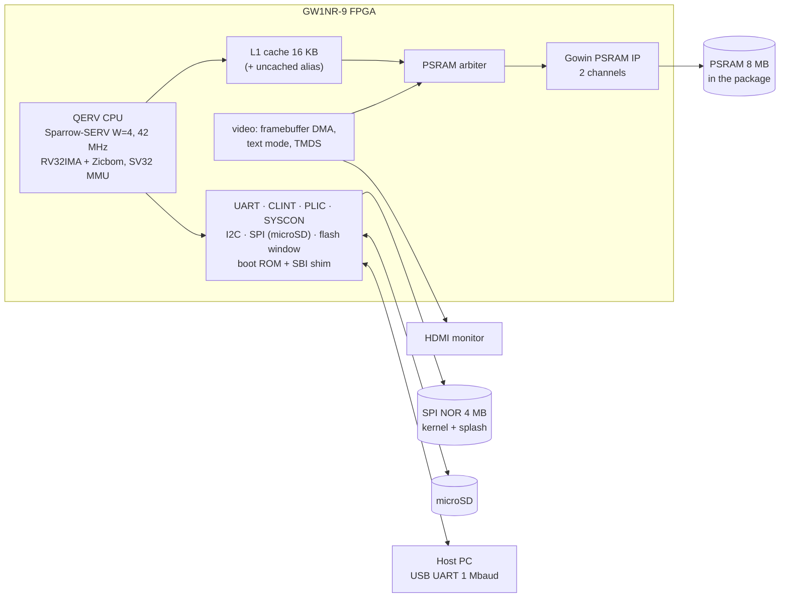

# tang_nano_9k_linux — Documentation

A **Gowin FPGA project** for the **Sipeed Tang Nano 9K** (GW1NR-9). It puts a bit-serial
RISC-V CPU (**QERV**, built on the [Sparrow-SERV](https://github.com/phoenix367/sparrow-serv)
fork of SERV) into the FPGA, with an SV32 MMU, a 16 KB cache in front of the 8 MB PSRAM in
the package, HDMI video, I2C and a microSD slot. It boots **RV32 Linux 6.18** with virtual
memory to a BusyBox shell.

This is not a typical software repo. The gateware is built with Gowin's `gw_sh`
(`fpga/build.sh`); the kernel and root file system with Buildroot (`sw/build.sh`); the
boot ROM and bare-metal tests with a RISC-V GCC. The CPU core is the `external/sparrow-serv`
submodule.

## What runs on the board

## Document map

| Doc | Contents |
|---|---|
| [01-architecture.md](01-architecture.md) | Hardware architecture: requirements and results, block diagram, clocks / CDC / reset, memory budget and arbitration, datapath, interfaces and address map, verification, implementation and timing, open issues |
| [stage1_plan.md](stage1_plan.md) | Stage 1, no-MMU Linux in M-mode: milestones M0–M4, the memory map, the CPU's Linux extensions, the resource budget |
| [stage2_plan.md](stage2_plan.md) | Stage 2, SV32 Linux in S-mode: the privilege modes, the MMU, the SBI shim, boot-time work |
| [video_plan.md](video_plan.md) | HDMI: the video controller, the PSRAM arbiter, the boot splash, the text console |
| [peripherals.md](peripherals.md) | I2C and the microSD card: drivers, hardware CRC, measurements, the open write problem |
| [psram_controller.md](psram_controller.md) | A self-written 16-bit PSRAM controller to replace the Gowin IP: design, what the board showed (pins, CR0, phase window), the probe, what SoC integration needs |

Elsewhere in the repository:
- `README.md`: what the project is, how to build, run and flash.
- `CLAUDE.md`: the detailed working notes, with build commands, hardware gotchas,
  measurements and what the board holds now.
- `external/sparrow-serv/README.md`: the CPU core's changes against upstream SERV.
- `verif/psram/NOTES.md`: how the PSRAM model was matched to the IP netlist.
- `.claude/skills/upload-kernel`, `.claude/skills/upload-bitstream`: how to load and flash
  the board.

## TL;DR facts

- **Device:** Gowin GW1NR-LV9QN88PC6/I5 (8,640 LUT4, 26 BSRAM, 2 rPLLs).
  `GOWIN_PATH=/mnt/data/Gowin_V1.9.12.02_SP2_linux`.
- **CPU:** QERV = Sparrow-SERV `W=4 LINUX=1 SMODE=1` + MDU + AMO unit + SV32 MMU. One hart,
  M/S/U, RV32IMA_Zicsr_Zifencei_Zicbom. About 12 cycles per ALU instruction, 22 per
  load/store.
- **Clocks:** 27 MHz crystal → memory clock 84 MHz → CPU and SoC 42 MHz (the PSRAM IP's user
  clock); video 126 MHz → pixel clock 25.2 MHz.
- **Memory:** 8 MB PSRAM (two 4 MB dies) behind a 16 KB direct-mapped write-back cache with
  32-byte lines. `0x8000_0000` cached, `0x9000_0000` uncached.
- **The defining constraints:** 8,640 LUTs (74% used) and 26 block RAMs (24 used); 8 MB of
  RAM (2.1 MB free after boot); a CPU that runs about 2 MIPS.
- **Boot:** internal flash → boot ROM (splash, 2 s autoboot) → kernel copied from the SPI
  flash → Linux in S-mode under the ROM's SBI v0.1 shim → `~ #` 24.6 s after the ROM prompt.
- **Peripherals:** UART `0x1000_0000` (PLIC 1), CLINT `0x1100_0000`, SYSCON and the video
  registers `0x1110_0000`, I2C `0x1130_0000` (PLIC 2), SPI/microSD `0x1140_0000`, text
  buffer `0x1180_0000`, PLIC `0x1200_0000`, flash window `0x2000_0000`.
- **Video:** 640 × 480 at 60 Hz over HDMI: an RGB565 framebuffer (`/dev/fb0`) and an
  80 × 30 hardware text console that mirrors the serial shell.
- **Timing:** cpu_clk 42.126 MHz against 42 (0.072 ns slack); the worst paths are inside the
  CPU.
